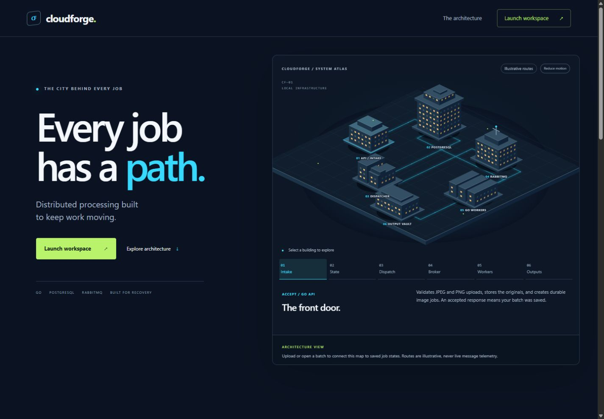
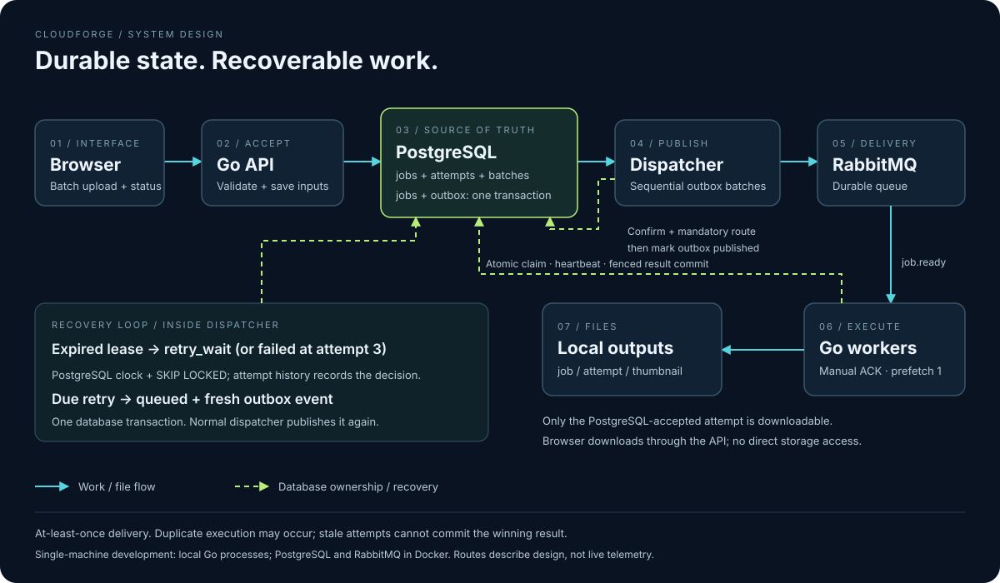
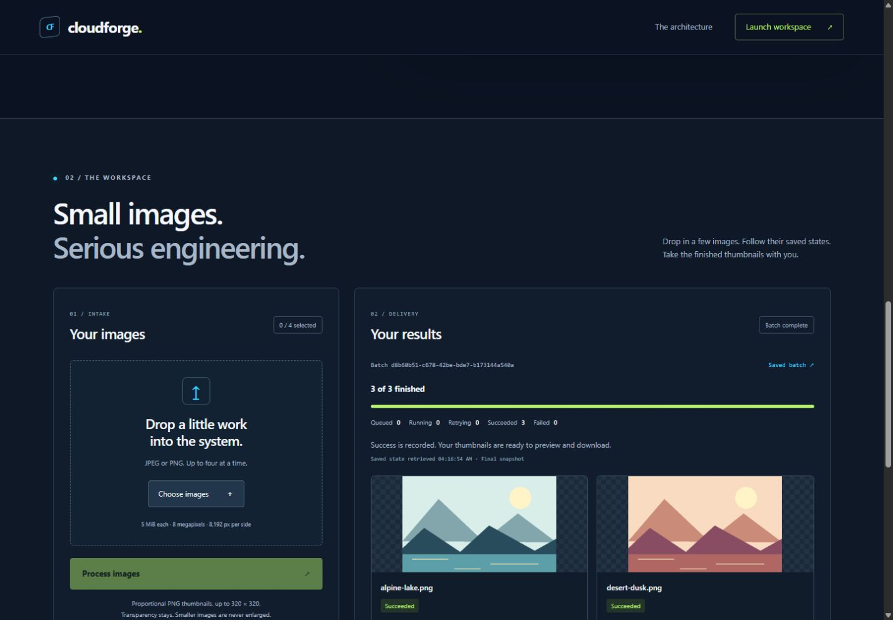

# CloudForge

**Fault-tolerant distributed job processing.**

CloudForge is a **Go-based distributed background-processing platform** built with PostgreSQL, RabbitMQ, transactional messaging, concurrent workers, bounded retries, and automatic crash recovery.

Its current practical application is **asynchronous image processing**: upload a small JPEG/PNG batch, let workers generate thumbnails in the background, and follow saved job states through to downloadable results.



[Quick start](#quick-start--windows) · [Architecture](docs/architecture.md) · [Reliability testing](docs/v5-recovery.md) · [Demo guide](docs/demo.md) · [v0.6.0 release](https://github.com/6kCraze/cloudforge/releases/tag/v0.6.0)

## The application

- Upload one to four JPEG/PNG images and generate proportional PNG thumbnails, including transparency.
- Monitor actual job states, retry timing, worker identity, and latest attempt details.
- Preview and download successful results, then reopen a saved batch link to retrieve its status.

## Engineering demonstrated

- **Transactional consistency:** jobs and outbox events commit together, so accepting work does not require an available broker.
- **Concurrent work delivery:** RabbitMQ competing consumers use manual acknowledgements and PostgreSQL atomic claims to handle duplicate notifications safely.
- **Crash recovery:** leases, heartbeats, bounded retries, and automatic redispatch recover abandoned jobs.
- **Result integrity:** attempt fencing and separate output paths stop stale workers from replacing the accepted result.
- **Reproducible verification:** isolated database/messaging integration tests, deterministic concurrency and fault tests, and hosted GitHub Actions checks support the implementation claims.

## Quick start · Windows

**Runs locally on your machine. There is no publicly hosted application.**

Prerequisites: **Git**, **Go matching [go.mod](go.mod)** (currently 1.27), **Docker Desktop with Compose and its Linux backend**, and **PowerShell 7 or Windows PowerShell 5.1**. Node.js is needed only for developer syntax checks, not application startup.

```powershell
git clone https://github.com/6kCraze/cloudforge.git
cd cloudforge
.\scripts\dev.ps1 setup -PullImages
.\scripts\dev.ps1 start
```

First setup creates a missing `.env` with generated local credentials, starts PostgreSQL/RabbitMQ and applies migrations. **For an existing database, review pending migrations and back up before `setup` or `migrate`.** Existing configuration is never overwritten; `start` never migrates. On subsequent runs, use `dev.ps1 infra` then `dev.ps1 start` to reuse cached images.

Open **[localhost:8080](http://localhost:8080/)** → **Launch workspace** → **Choose images**. Select the three small [included demo images](samples/README.md), then **Process 3 images**. Small jobs can finish between polls; the interface does not invent a visible running interval. Expand **Latest attempt details**, download a PNG, and reload the saved batch link.

The foreground launcher runs the API, dispatcher and **one worker** as local Go processes. Only PostgreSQL and RabbitMQ use Docker. No frontend build or application container build is required. Use `dev.ps1 status` from another terminal to inspect service readiness and broker counters.

To stop: press **Ctrl+C once** in the foreground start terminal, let the Go processes finish, then run:

```powershell
.\scripts\dev.ps1 stop
```

This preserves named volumes, database rows and uploaded files. It refuses to stop infrastructure while the application is active. Do not remove volumes as routine cleanup.

See [setup, configuration and troubleshooting](docs/development.md). API and workers must share the same absolute `STORAGE_ROOT`; blank uses the per-user `CloudForge/storage` cache. The broker UI is [localhost:15672](http://localhost:15672/), with credentials from your own `.env`. Never commit private configuration or uploads.

Limits: **four files, 5 MiB each, 21 MiB per batch request, 8 megapixels and 8,192 pixels per side**. Thumbnails fit within **320 × 320** without upscaling. Storage has a conservative 256 MiB local admission budget. [API and storage details](docs/v4-image-workflow.md).

## Architecture



**PostgreSQL is the source of truth** for job lifecycle, attempts, retry decisions, and output references. **RabbitMQ delivers work notifications.** One dispatcher publishes outbox events with confirmations and runs a separate recovery loop; workers claim jobs under leased database ownership and write attempt-specific outputs.

The browser's infrastructure city explains these responsibilities. Its routes are **illustrative architecture**, not live broker telemetry or a measured worker count.

Read the [architecture and lifecycle](docs/architecture.md) for transaction boundaries and failure windows, [worker ownership](docs/v5-safe-ownership.md) for fencing, and [recovery and fault evidence](docs/v5-recovery.md) for the reliability validation. The original synthetic SHA-256 API remains supported; [engineering history](docs/engineering-history.md) explains how the system evolved.

## Testing and evidence

```powershell
.\scripts\test.ps1                       # formatting, JS syntax, script safety, build, Go tests and vet
# Integration: infrastructure running, application processes stopped.
.\scripts\setup-test-infrastructure.ps1  # existing containers; restricted test database/account/vhost
.\scripts\test.ps1 -Integration          # sequential real database/messaging/image/recovery checks
```

Integration tests refuse development targets and use `cloudforge_test`, a restricted role/vhost, and temporary storage. Stop application processes before shared integration tests. Deterministic two-worker processors prove concurrency without CPU stress. Heavy real process-crash and broker-interruption cases are explicit opt-in checks; they are not repeated just for screenshots.

The [v0.6.0 main CI run passed](https://github.com/6kCraze/cloudforge/actions/runs/40786060526). [Current main CI](https://github.com/6kCraze/cloudforge/actions?query=branch%3Amain) records later outcomes. Real browser evidence includes upload → outbox → RabbitMQ → worker → PNG download, saved-batch reload, and controlled retry/failure presentation. See [test isolation](docs/integration-testing.md), [CI coverage](docs/ci.md), [tooling validation](docs/v6-engineering-validation.md), and [portfolio/browser evidence](docs/v6-portfolio-validation.md) for what each check proves and what remains unverified. No throughput, uptime, or production-scale benchmark is claimed.

## Product demo and screenshots



[Desktop workspace](docs/images/workspace.jpg) · [Worker/attempt details](docs/images/job-details.jpg) · [Mobile](docs/images/mobile.jpg) · [Controlled retry/failure evidence](docs/images/retry-test-evidence.jpg).

All are authentic local browser captures. The retry screenshot uses deterministic isolated test faults, not production telemetry or a development crash. [Sample artwork and credits](samples/README.md) are included. [Recording steps and a 60–90 second narration](docs/demo.md) make the demo reproducible; no recording is claimed.

## Scope and limitations

- Single-machine local deployment and shared filesystem; no authentication or hosted service. Default API and Docker port bindings are not restricted to loopback; keep this development setup off untrusted networks.
- At-least-once delivery, not exactly-once execution. Duplicate CPU work is possible; fenced commits protect the accepted result.
- Input/candidate orphans are retained; automatic storage reconciliation and garbage collection are not implemented.
- One dispatcher is supported. Malformed events are retained and logged; a full oldest batch of malformed events can still starve later rows.
- The UI exposes the latest saved attempt, not a complete event history or measured broker movements.
- Cancellation, additional image operations, Redis, S3/MinIO, packaging and tracing are optional backlog.

See [architecture limits](docs/architecture.md#observable-facts-and-honest-limits), the [roadmap](docs/roadmap.md), and the [historical engineering milestones](docs/engineering-history.md). The original V1 stuck-running crash demonstration remains documented in the history as the observed problem V5 recovery solves.
