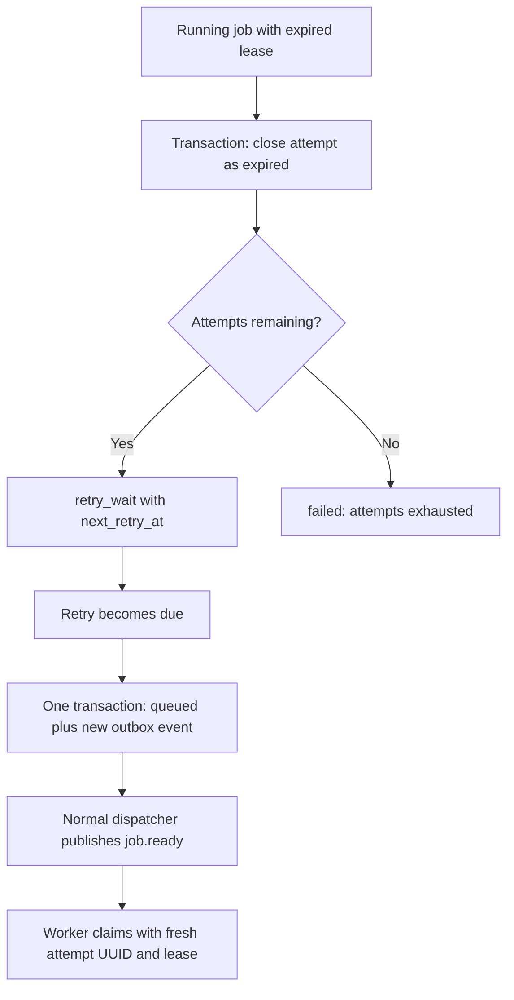
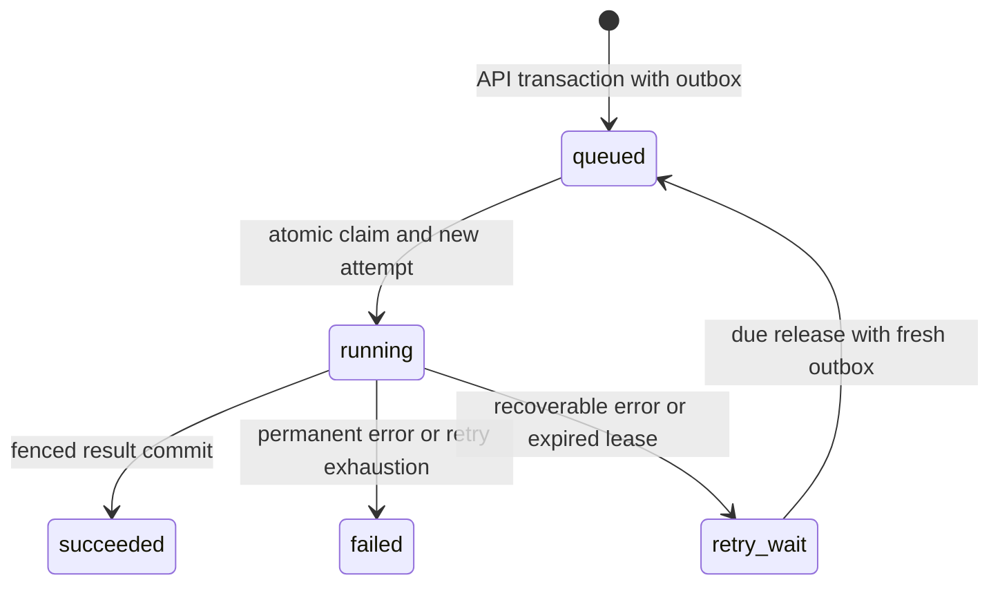

# Architecture and reliability

## One upload, end to end

1. The browser uploads one to four JPEG/PNG files to the Go API. The API validates bounded image inputs and finalizes their local input files, then commits the batch, jobs and matching outbox rows in one PostgreSQL transaction. File I/O and database commit are not a distributed transaction.
2. One dispatcher reads ordered batches of up to 16 unpublished events. It publishes sequentially to durable exchange `cloudforge.jobs`, routing key `job.ready`, and queue `cloudforge.jobs.v1`. Persistent delivery, publisher confirms and mandatory returns detect broker acceptance and routing errors. Only confirmed, routed events receive `published_at`. Network calls occur outside database transactions.
3. Go workers compete on that queue with manual ACK and prefetch one. A conditional PostgreSQL claim changes only `queued` to `running`, increments the attempt count, creates a fresh attempt UUID and grants a lease. Duplicate notifications cannot simultaneously claim the same job. Legacy claim-next and recovery scans retain `FOR UPDATE SKIP LOCKED`.
4. The owner renews its lease while executing. Terminal writes require the job, worker, attempt UUID, running state and an unexpired lease. A durable terminal or retry decision precedes ACK; temporary persistence errors requeue the delivery. An already running or terminal job can be ACKed without re-execution because recovery is database-driven.
5. The image processor creates an exclusive candidate at `outputs/<job_id>/<attempt_id>/thumbnail.png`. A fenced PostgreSQL success result references the winning candidate. Downloads through the API resolve that saved result; a stale worker cannot overwrite another attempt's file or commit its result. Older V4 output references remain readable.

PostgreSQL is authoritative for jobs, attempts, retry decisions and output references. RabbitMQ represents delivery: Ready/Unacked are broker counters, not application job states. There is no retry queue or DLQ. Application failure history belongs in PostgreSQL.

## Recovery belongs to the dispatcher process

`cmd/dispatcher` runs both confirmed publication and a separate lightweight recovery loop. Recovery does not depend on an active broker connection. It uses the PostgreSQL clock, short transactions and ordered `SKIP LOCKED` batches:

The expiry decision and due release are **two separate database transactions**. The due transition to `queued` and its fresh outbox event are atomic together. Retry generations distinguish new delivery intent from duplicate publication of an older event. This avoids relying on RabbitMQ redelivery to recover a job whose former owner already ACKed another notification.

Default ownership is a 30-second lease renewed every five seconds. Recoverable processing failures or expired attempts get at most three total attempts; normal backoff is one second, then two seconds (configured maximum four seconds). Permanent input errors fail immediately. Renewal errors cancel processing; an expired worker may still finish computation, but its terminal update is rejected.

## Lifecycle

`cancelled` is deferred. Graceful shutdown cancels intake and lets the current delivery reach a durable decision; it is not user-requested job cancellation.

## Why these choices matter

| Failure window | Implemented protection | Boundary |
| --- | --- | --- |
| API accepts work while broker is unavailable | Jobs and outbox commit together; dispatcher catches up later | Requires PostgreSQL and eventual dispatcher/broker availability |
| Dispatcher crashes after broker acceptance, before marking published | Unmarked event publishes again | At-least-once; duplicate notifications are expected |
| Two workers receive the same job ID | Conditional PostgreSQL claim elects one current owner | Does not promise only one execution over the entire lifetime |
| Worker crashes during processing | Expired lease becomes a bounded retry; due job gets new outbox | Recovery pauses while dispatcher or PostgreSQL is unavailable |
| Old worker completes after ownership expires | Lease and attempt fence rejects its write | Duplicate CPU work can happen |
| Old worker writes an image candidate | Attempt-specific exclusive paths and saved winning reference | Orphan files remain until future reconciliation |

## Observable facts and honest limits

The browser reads saved batch/job states, current/latest attempt identity, worker assignment, retry due time and available timestamps. City routes are illustrative, never broker traffic telemetry. The API does not expose the full `job_attempts` history, so the UI intentionally does not synthesize a complete per-job event timeline. A future history endpoint could support one without inventing intermediate timestamps.

This is a single-machine development deployment: PostgreSQL and RabbitMQ run in Docker; API, dispatcher and workers run locally and share one filesystem. No authentication, hosted deployment, distributed storage, storage reconciliation or orphan-file garbage collection is implemented. A crash can leave unreferenced input/candidate files. Local admission limits bound ordinary usage; they are not a multi-host storage coordination protocol.

Malformed outbox events remain unpublished and logged. Later valid events within the same 16-row batch progress, but a full oldest batch of malformed events can still starve later rows. Operational quarantine, pagination or a failure policy would require a separate design change. One dispatcher is the supported configuration.

See [V5 ownership](v5-safe-ownership.md), [recovery and fault evidence](v5-recovery.md), [isolated testing](integration-testing.md), and [CI scope](ci.md) for implementation detail and proof. Redis, cloud packaging, cancellation and additional image operations remain optional backlog, not release prerequisites.
